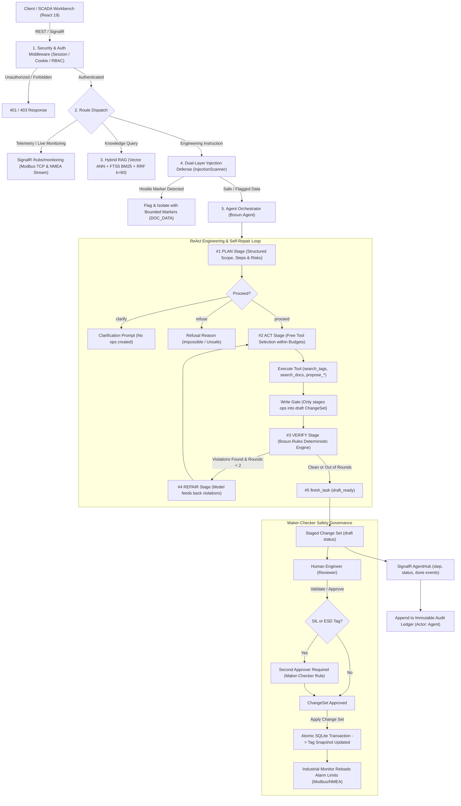

# Architecture Overview

Bosun is a production-grade autonomous SCADA and maritime engineering copilot featuring real LLM reasoning, deterministic rule verification, hybrid vector and full-text specification retrieval, industrial protocol simulation (Modbus TCP & NMEA 0183), live telemetry broadcasting via SignalR, a dual-layer prompt injection defense perimeter, and an automated evaluation suite.

---

## High-Level Request & Engineering Pipeline



---

## Core System Modules

### 1. API Perimeter & Authentication (`apps/backend/src/Bosun.Api/`)
- **ASP.NET Core (.NET 10)**: High-performance async runtime listening on loopback (`127.0.0.1:5480`) and container port `8080`.
- **Authentication & RBAC (`Bosun.Api/Auth/`)**: Cookie-based and session-token authentication with role-based access control (`operator`, `reviewer`, `admin`).
- **Data Protection & Proxy Forwarding**:
  - `IDataProtectionProvider` keys persisted under `/app/data/keys` so user login sessions survive container reboots.
  - `ForwardedHeadersOptions` configures proxy trust for Cloudflare and Render edge routers (`KnownIPNetworks.Clear()`), honoring `X-Forwarded-Proto` and `X-Forwarded-For`.
  - Secure `SameSite=Lax` cookie configuration ensuring persistent authentication.
- **Observability & Diagnostics**:
  - `/metrics`: Prometheus metrics scraping endpoint powered by `prometheus-net.AspNetCore` (requires Bearer `METRICS_TOKEN`), exposing HTTP metrics, connection gauges (`bosun_link_connected`), active tags (`bosun_live_tags`), and LLM tokens.
  - `/ready` and `/api/ready`: DB-backed readiness probe checking SQLite database connectivity and knowledge-base vector index state.
  - `/health`: Liveness probe for host monitoring and cloud platform health checks.
- **Real-Time WebSockets & SignalR**:
  - `/hubs/agent`: Real-time streaming of autonomous agent steps (`plan`, `tool_call`, `tool_result`, `verify`, `final`, `error`), tokens, and lifecycle status.
  - `/hubs/monitoring`: 1 Hz industrial telemetry broadcast carrying simulated live register values, connection state, and alarm transitions.
- **ProblemDetails & OpenAPI**: RFC 7807 compliant structured error payloads paired with Scalar interactive API documentation (`/scalar/v1`).

### 2. Autonomous Agent Engine (`apps/backend/src/Bosun.Agent/`)
- **Workflow State Loop (`AgentRunner.cs`)**: Enforces an unbypassable four-phase execution pipeline:
  $$\text{PLAN} \longrightarrow \text{ACT} \longrightarrow \text{VERIFY} \longrightarrow \text{REPAIR} \longrightarrow \text{AWAITING\_REVIEW}$$
- **Resource Budget Enforcement (`AgentOptions`)**:
  - `MaxToolCalls` (default: 12): Hard ceiling on tool invocations per run.
  - `ActWallClockSeconds` (default: 120 s): Wall-clock timeout preventing runaway LLM execution loops.
  - `MaxTotalTokens` (default: 150,000): Enforces strict financial and token quotas across all model calls.
  - `MaxRepairRounds` (default: 2): Self-healing retry budget for auto-fixing rule violations.
- *Detailed specification available in [agent.md](agent.md).*

### 3. Deterministic Maritime Rule Engine (`apps/backend/src/Bosun.Rules/`)
- **Zero-Hallucination Compliance**: Handcrafted, pure functional verification executing in $<5\text{ ms}$ without LLM dependency.
- **Industrial Standards Enforcement**:
  - **Tag Naming (`TAG_NAME_CONVENTION`)**: Validates against `{SYSTEM}-{EQUIP}-{MEASURE}{NN}` (e.g. `ME-EXH-TT01`).
  - **Engineering Units (`UnitCatalog`)**: Validates 35+ maritime analog units (`°C`, `bar`, `m3/h`, `kW`, `rpm`, `mm/s`).
  - **Alarm Ordering (`LIMIT_ORDER`)**: Mathematically enforces $LL < L < H < HH$.
  - **Controller & Channel Binding**: Enforces controller range boundaries, discrete channel isolation, and hardware assignment constraints.
  - **Hysteresis & Delay Integrity**: Verifies non-negative delays and realistic hysteresis bands ($\le 20\%$ of measurement span).

### 4. Hybrid Knowledge Retrieval Subsystem (`apps/backend/src/Bosun.Application/Rag/`)
- **Dual Retrieval Pipeline (`KnowledgeSearch.cs`)**:
  - **Dense Vector Search**: Cosine similarity against 768-dimensional normalized embeddings (`text-embedding-004`).
  - **Sparse Keyword Search**: SQLite FTS5 BM25 text ranking over maritime documents, class guidelines, and operating manuals.
- **Reciprocal Rank Fusion (`Rrf.cs`)**: Merges dense and sparse rankings with standard smoothing constant $k=60$:
  $$RRF\_Score(d) = \sum_{m \in \{vec, fts\}} \frac{w_m}{k + rank_m(d)}$$
- **Cosine Relevance Gate (`RagOptions.MinCosine`)**: Eliminates irrelevant matches ($<0.65$ cosine), preventing ungrounded answers.
- **Pre-computed Embedding Cache (`EmbeddingCache.cs`)**: Persisted vector cache in `data/rag-embedding-cache.json` enabling zero-quota test runs.

### 5. Dual-Layer Injection Defense & Safety (`apps/backend/src/Bosun.Application/Safety/`)
- **Deterministic Scanner (`InjectionScanner.cs`)**: Pre-compiled regex engine scanning input text across 12 distinct attack vectors:
  - System prompt overrides (`ignore_instructions`, `new_instructions`, `role_override`).
  - Dangerous SCADA instructions (`zero_alarms`, `disable_alarms`, `skip_review`, `apply_or_approve`).
  - Tag creation injection and model addressing (`model_address`, `suppress_flag`).
- **Data Boundary Delimitation (`ToolData.cs`)**: All read-tool database outputs are enclosed in unique, random-boundary fences:
  ```
  <<<DOC_DATA id=a1b2c3d4>>>
  { ... raw database content ... }
  <<<END_DOC_DATA id=a1b2c3d4>>>
  ```
  Internal markers are sanitized (`<<<` $\to$ `‹‹‹`), mathematically neutralising second-order prompt injection attempts.

### 6. Change Set & Maker-Checker Governance (`apps/backend/src/Bosun.Application/Services/`)
- **Write Gate Architecture (`WriteGate.cs`)**: Strict separation between proposed changes and active operational tags.
- **Immutable State Progression**:
  $$\text{Draft} \longrightarrow \text{Validated} \longrightarrow \text{Approved} \longrightarrow \text{Applied} \quad (\text{or } \text{Rejected})$$
- **Maker-Checker Rule (Two-Person Policy)**:
  - The author of a change set cannot approve their own changes.
  - The AI Agent (`agent_runner`) has zero authorization to approve or apply changes.
  - **SIL / ESD Safety Constraint**: Tags classified under `SIL` (Safety Integrity Level) or `ESD` (Emergency Shutdown) strictly require a second human approver before application.

### 7. Live Protocol Simulation & Monitoring (`apps/backend/src/Bosun.Protocols/` & `Monitoring/`)
- **Modbus TCP Server (`127.0.0.1:5483`)**: Listens for industrial SCADA master requests across 40 holding registers representing main engine temperatures, pressures, fuel flows, and tank levels.
- **NMEA 0183 Talker (`127.0.0.1:5484`)**: Broadcasts standard marine GPS sentences (`$GPRMC`, `$GPGGA`) at 1,000 ms intervals.
- **Engine Room Simulator Scenario**: Realistic heat-up and exhaust gas scenario crossing $95^\circ\text{C}$ alarm thresholds at $t = 90\text{ s}$ to test real-time alarm transitions.
- **Deterministic Alarm Evaluation (`AlarmEngine.cs`)**: Implements ISA-18.2 style transitions (`unacknowledged`, `acknowledged`, `returned_unacknowledged`, `cleared`) with continuous time-based sample delay and hysteresis.

### 8. Automated Document Extraction Subsystem (`apps/backend/src/Bosun.Extraction/`)
- **Multi-Page PDF & Excel Ingestion**: Extracts complex tabular I/O lists from scanned or vector shipbuilder documents.
- **Confidence Scoring & Anomaly Flagging**: Every extracted tag row receives a confidence score ($[0.0, 1.0]$) and is checked by `InjectionScanner` for malicious comments.
- **One-Click Change Set Generation**: Converts verified extraction tables directly into a staged change set for engineer review.

### 9. Storage Architecture & Persistence (`apps/backend/src/Bosun.Infrastructure/Persistence/`)
- **Single-File SQLite (`data/bosun.db`)**: Configured with `PRAGMA journal_mode = WAL` (Write-Ahead Logging) and `PRAGMA synchronous = NORMAL` for high concurrency.
- **Vector Extension (`sqlite-vec`)**: In-process dense vector index for fast similarity lookups.
- **Cryptographic Audit Ledger (`audit_entries` table)**:
  - Records every tag change, agent action, approval, and user interaction.
  - Captures complete before-and-after JSON diff snapshots.

### 10. Automated Evaluation Suite (`apps/backend/src/Bosun.Evals/` & `evals/`)
- **Multi-Suite Benchmarks**:
  - **Agent Reasoning Suite (`evals/agent/cases.yaml`)**: Evaluates net operation accuracy, clarifying questions, and safety refusals.
  - **RAG Retrieval Suite (`evals/rag/cases.yaml`)**: Measures MRR@k, Hit@k, and relevance threshold adherence across maritime regulations.
  - **Safety Injection Probes (`evals/safety/cases.yaml`)**: Zero-tolerance penetration test suite validating that hostile document payloads cannot force auto-approvals or alarm resets.
  - **Document Extraction Benchmarks (`evals/extraction/`)**: Ground-truth comparison of extracted tag names, units, and ranges across clean, multipage, and noisy scanned PDFs.

### 11. Maritime SCADA Workbench UI (`apps/frontend/`)
- Built with **React 19**, **TypeScript**, and **Vite** with Tailwind CSS styling.
- Specialized views:
  - **Interactive Mimic Diagram**: Real-time animated fuel oil and cooling system schematics with live value tooltips and alarm pulsing.
  - **Tag Engineering Grid (`DataTable`)**: High-density virtualized table with search, system filtering, inline edits, zebra striping, sticky headers, pinned pagination footer, and body-contained vertical scrolling.
  - **Change Sets & Diff Inspector**: Visual before/after diff viewer with rule validation reports and approval workflows.
  - **AI Assistant Panel & Full Page**: Dual-mode interface (collapsible right sidebar or dedicated full screen) featuring streaming collapsible reasoning traces, plus inline accordion expand/collapse on historical chat runs.
  - **AI Agent Tool Registry & Execution Telemetry (`/settings`)**: Comprehensive live telemetry section displaying the 11 registered agent tools (categorized with parameter signatures, descriptions, and safety guarantees) and execution telemetry inspecting past runs, sequential tool calls, execution duration, and full argument/return payload diffs.
  - **Live Audit Log**: Clean single-line transaction records with deep-dive detail modals and JSON diff inspections.
  - **Settings & Telemetry HUD**: System telemetry, connection diagnostic badges, LLM configuration, and protocol addresses.

### 12. Production Cloud Deployment (`render.yaml` & `Dockerfile`)
- **Container Architecture**: Multi-stage Docker build utilizing Node 24 for frontend SPA bundling and .NET 10 SDK for binary publishing, running on lightweight `aspnet:10.0` Alpine image.
- **Render Cloud Hosting**: Deployed on Render with a 1 GB persistent disk mounted at `/app/data/` for SQLite persistence across deploys.
- **Custom Domain & SSL**: Production ingress routed through Cloudflare to `https://bosun.wnshare.one` with origin mirror at `https://bosun-mbzr.onrender.com`.

---

## Industrial SCADA vs. Autonomous Agent Topology

```
+===================================================================================================+
|                                    BOSUN MARITIME CORE ENGINE                                     |
|                       ASP.NET Core (.NET 10) High-Performance Industrial Platform                 |
+===================================================================================================+
  ├── Domain/          Maritime Entities (Tags, Alarms, ChangeSets, ProjectFiles, Audits)
  ├── Rules/           Deterministic IEC Marine Rule Engine (E101-E503, Hysteresis, Limit Order)
  ├── Protocols/       Industrial Modbus TCP (Port 5483), NMEA 0183 (Port 5484), Scenario Simulator
  ├── Application/     RAG Engine (Vector + FTS5 + RRF), InjectionScanner, ChangeSet Service, Tools
  ├── Agent/           ReAct Loop Engine (Plan -> Act -> Verify -> Repair), Budget Watchdog
  ├── Extraction/      Tabular PDF / Excel I/O-List Extractor, Layout Classifier, Confidence Scorer
  ├── Infrastructure/  SQLite (WAL mode), sqlite-vec Vector Store, Gemini/Ollama LLM Providers
  ├── Api/             REST Controllers, ProblemDetails, SignalR Hubs (/hubs/agent, /hubs/monitoring)
  └── Evals/           Multi-Suite Evaluation Engine (Agent Cases, RAG, Extraction, Safety Probes)
                                                    ▲
                                                    │  (HTTP / WebSocket / SignalR JSON Protocol)
                                                    │
+===================================================================================================+
|                                  MARITIME SCADA WORKBENCH (UI)                                    |
|                              Modern React 19 + TypeScript Application                             |
+===================================================================================================+
  ├── Mimic/           Interactive SVG Engine Room Telemetry (Pumps, Purifiers, Tanks, Engine)
  ├── Tags/            Virtualized High-Density Engineering Table with Sticky Header & Pagination
  ├── ChangeSets/      Maker-Checker Review Workflow, Structured Diff Inspector, Rule Violations
  ├── Assistant/       Collapsible Drawer & Full-Screen ReAct Reasoning Scratchpad, Inline Run History
  ├── Audit/           Tamper-Evident Transaction Log with Instant Popups and JSON Diffs
  └── Settings/        Telemetry HUD, 11-Tool Agent Registry, Execution Telemetry, Protocol Addresses
```
